<a href="https://github.com/sarang-cmd"></a>



<a href="https://github.com/sarang-cmd?tab=repositories"></a>
<a href="https://github.com/sarang-cmd/road-to-cs336"></a>
<a href="https://github.com/sarang-cmd/sarang-cmd/issues"></a>

  <a href="https://github.com/sarang-cmd">GitHub</a> &nbsp;|&nbsp;
  <a href="https://linkedin.com/in/sarang-batra">LinkedIn</a> &nbsp;|&nbsp;
  <a href="https://instagram.com/sarangde.v">Instagram</a> &nbsp;|&nbsp;
  <a href="mailto:sarang.cmd@gmail.com">Gmail</a> 
  Let me know you came from my GitHub. Ask me anything in the <a href="https://github.com/sarang-cmd/sarang-cmd/issues">issues</a>.

<h3 align="left">Featured projects</h3>

<a href="https://github.com/sarang-cmd/sarang.md"></a>
<a href="https://github.com/sarang-cmd/lm-subs"></a>
<a href="https://github.com/sarang-cmd/road-to-cs336"></a>
<a href="https://github.com/sarang-cmd/study-with-sarang"></a>

  Live: <a href="https://sarang-md.vercel.app/">Sarang.md</a> &nbsp;|&nbsp;
  <a href="https://lm-subs.vercel.app/">LM Subs</a> &nbsp;|&nbsp;
  <a href="https://sarang-cmd.github.io/road-to-cs336/">CS336 roadmap</a> &nbsp;|&nbsp;
  <a href="https://sarang-md.vercel.app/study-with-sarang/">Study With Sarang</a>


Perplexity Autorename is a [Chrome extension](https://github.com/sarang-cmd/perplexity-autorename) that renames Perplexity threads to short titles. [Flow](https://github.com/sarang-cmd/flow) is in development.
I am working through a self-built AI/ML roadmap toward Stanford CS336. [Check it out](https://github.com/sarang-cmd/road-to-cs336). I am looking for collaborators and project ideas. Ask me about any project. Pronouns: he/him.


  
  

